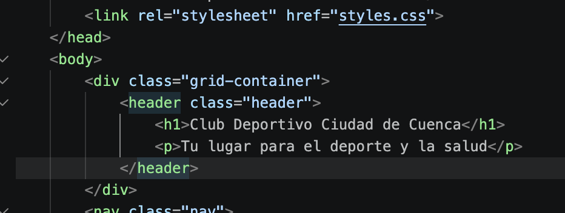
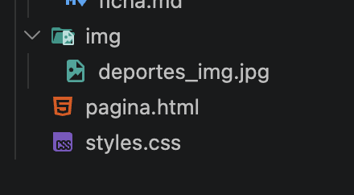

# Informe de Auditoría - Compañero 9

**Auditor:** Daniel Antonio Durá Ochoa
**Ficha Auditada:** 9 (Club deportivo, Correo con pattern, Breakpoint 600px, Modo oscuro con prefers-color-scheme sin duplicar)

## Tabla de Hallazgos

| N.º | Requisito | Ubicación (archivo y línea o selector) | Hallazgo | Norma que incumple | Evidencia | Severidad (alta, media, baja) |
|---|---|---|---|---|---|---|
| 1 | Base 1: Base estructura semantica | `pagina.html` | EL documento carece de elementos `<h2>` dentro de la etiqueta `main` o al inicio del contenido principal `<header>`| Especificación HTML WHATWG (Jerarquía de encabezados) | | Baja |
| 2 | Entregables (Nombres de archivos) | Raíz del proyecto | Los archivos principales se nombraron `pagina.html` y `styles.css`. Según la estructura exigida para el repositorio, deben ser estrictamente `index.html` y estar dentro de una carpeta CSS como `css/estilos.css`. | Instrucciones generales (Sección Entregables) |  | Media |

## Notas adicionales:
* **Puntos fuertes detectados:** La accesibilidad del formulario (Base 2) es excelente, con etiquetas `<label>` bien asociadas. La restricción especial de modo oscuro sin duplicar código también fue implementada a la perfección utilizando reasignación de variables en la regla `prefers-color-scheme`.